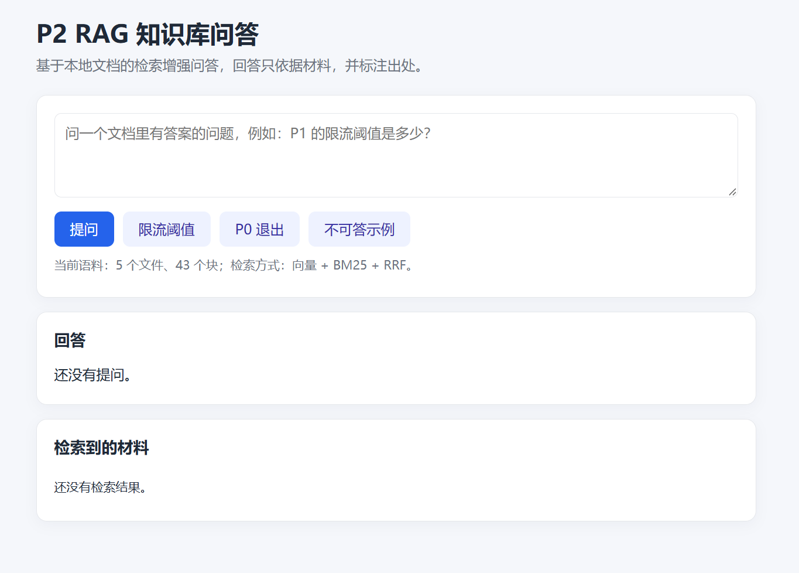

# P2 · RAG 知识库问答（手写最小链路 + 混合检索）

从零手写的检索增强问答（RAG）最小实现：把本地文档切块、向量化、检索，再用对话模型基于检索结果回答，并要求每条结论标注出处；材料不足时明确拒答。

在线演示：http://43.142.41.234:8001

这是 Agent 应用开发学习路线的第三个项目，前两个是：

- P0 · 多轮流式对话 CLI：https://github.com/leijixu/p0-llm-basics
- P1 · FastAPI 对话服务：https://github.com/leijixu/p1-llm-api

## 功能

- Markdown 标题/段落切块，识别代码围栏，超长 block 硬切
- 阿里云百炼 `text-embedding-v3` 向量化（1024 维）
- 混合检索：向量余弦 + BM25 关键词，RRF 按名次融合，按项目来源过滤
- 文档向量缓存：按“模型 + 全部块文本”的哈希失效，重复运行不重复 embed
- Prompt 约束：只依据材料、标注 `[文件名#序号]`、冲突提示、存在性/缺席区分
- 自动评测：41 题（36 可答 + 5 不可答），当前 41/41
- 诊断命令：关键词排名、混合排名、单题检索排名

## 链路

```text
读文档 -> 切块 -> embedding -> 混合检索 -> 拼 prompt -> 对话模型
          |          |            |
          |          |            +-- 向量余弦 + BM25 + RRF + 来源过滤
          |          +-- 百炼 text-embedding-v3（1024 维）
          +-- 标题路径 / 代码围栏 / 超长 block 硬切
```

## 快速开始

依赖 Python 3.14、`numpy`、`openai`：

```powershell
pip install -r requirements.txt
```

复制 `.env.example` 为 `.env`，填入两个 key：

```text
DASHSCOPE_API_KEY=sk-你的百炼key
DEEPSEEK_API_KEY=sk-你的DeepSeek key
```

常用命令：

```powershell
python rag.py chunk                          # 只看切块结果
python rag.py keyword "time.monotonic"       # 只看 BM25 关键词排名
python rag.py hybrid "P1 的限流阈值是多少"    # 只看混合检索排名
python rag.py prompt "P1 的限流阈值是多少"    # 只看拼出来的 prompt
python rag.py ask "P1 的限流阈值是多少"       # 完整问答
python run_eval.py                           # 跑 EVAL.md 里的全部题目，结果写入 EVAL_RUN.md
```

第一次运行会把文档块 embed 一遍，写到 `.cache/embeddings.npz`；之后只要文本和模型没变，就直接读缓存，只 embed query。改了切块参数或文档内容，哈希变化，缓存自动失效重算。

## Web 演示

```powershell
uvicorn app:app --host 0.0.0.0 --port 8000
```

打开 http://127.0.0.1:8000 。启动时加载一次文档块和向量矩阵，之后每次提问只 embed query。页面会显示回答和检索到的材料（出处、标题、分数）。



防护：`/ask` 按 IP 限流（60 秒 10 次），问题最长 500 字；`/health` 和 `/static` 不限流。

## Docker 部署

```powershell
docker build -t p2-rag-qa .
docker run -d --name p2-rag-qa --env-file .env -p 8001:8000 --restart unless-stopped p2-rag-qa
```

密钥通过 `--env-file` 运行时注入，不进镜像层。容器内只开 1 个 uvicorn worker，因为索引在内存里。公网访问需要安全组放行 8001。

## 数据

- 仓库自带 `samples/`：P0/P1 的 README 和源码，clone 下来即可直接跑
- `data/` 为空或不存在时，自动使用 `samples/`
- 放自己的文档到 `data/`（支持 `.md`、`.py`），`data/` 已被 gitignore
- 当前语料：5 个文件、43 块

## 评测

评测集在 `EVAL.md`，结果记录在 `EVAL_RESULTS.md`。历史上做过的对照：

| 版本 | 改动 | 总分 |
|---|---|---|
| baseline | 纯向量，TOP_K=3 | 12 / 13 |
| top5 | 纯向量，TOP_K=5 | 13 / 13 |
| hybrid v3 | 向量 + BM25 + RRF + 停用词 | 13 / 13 |
| corpus35 v1 | 扩语料到 5 文件 43 块 | 34 / 35 |
| corpus35 v2 | 加项目来源过滤 | 35 / 35 |
| **41 v2** | **prompt 加存在性/缺席规则** | **41 / 41** |

关键结论：

- 只靠向量，遇到 `time.monotonic`、`429`、`DEFAULT_TIMEOUT` 这种精确词会漏召回；BM25 补上了这块。
- 项目名 `p0`/`p1` 不能当内容词，但可以当来源过滤器，避免 P0/P1 同名函数混淆。
- “有没有 X”和“X 是什么”要分开处理，否则模型会对存在性问题过度保守、对缺席过度断言。

## 关键文件

| 文件 | 作用 |
|---|---|
| `rag.py` | 主链路：切块、embedding、混合检索、prompt、generate |
| `app.py` | FastAPI 后端：启动加载索引，提供 `/ask`、`/health` |
| `static/index.html` | 极简 Web 页面：提问、显示回答和出处 |
| `run_eval.py` | 自动跑评测集，结果写 `EVAL_RUN.md` |
| `diag_rank.py` | 诊断单个问题的检索排名 |
| `EVAL.md` | 41 题评测集 |
| `EVAL_RESULTS.md` | 评测记录与对照 |
| `probe_embedding.py` | embedding 接口探测脚本 |

## 已知局限

- 关键词检索只处理英文/数字，中文没有分词（靠向量兜底）
- 没有 rerank，top-k 之外的块没有二次排序
- 评测集只有 41 题，仍偏小，可能存在过拟合
